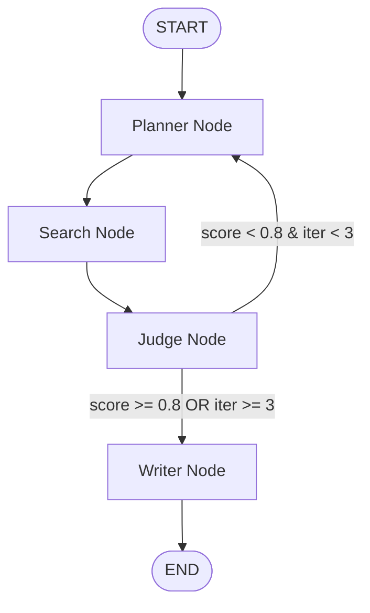

# Research Syndicate

If you want to research a highly technical topic, you usually end up digging through dozens of search pages, skipping past SEO marketing blogs, and manually parsing whitepapers just to find something reliable. It takes hours of manual filtering to get to a trustworthy answer.

Research Syndicate automates that workflow. It's a headless, multi-agent system built on LangGraph that acts like a small team of strict academic researchers. You give it a topic, and a cyclical graph of specialized agents plans queries, retrieves sources, grades them for academic rigor, and only writes a cited report once the sources actually clear a quality bar — regenerating the search itself if they don't.

## How the Graph Works

Instead of a single prompt trying to do everything at once, the system is an asynchronous `StateGraph` with four nodes, a self-correcting loop, and a circuit breaker:



**1. Planner** — Takes the raw topic and calls Gemini 2.5 Flash with a structured output schema (`PlannerOutput`) to produce 3–5 highly specific academic search queries, deliberately biased toward arXiv, IEEE, and DOI-style phrasing. On retries, it ingests previous `judge_feedback` to dynamically refine query strategy.

**2. Search** — Runs all queries concurrently via `AsyncTavilyClient` using `asyncio.gather`, restricted to a fixed allowlist of academic domains (`arxiv.org`, `ieeexplore.ieee.org`, `sciencedirect.com`, `nature.com`, `springer.com`, `researchgate.net`). Results accumulate into `raw_sources` using a LangGraph reducer (`Annotated[List[dict], operator.add]`).

**3. Judge** — Acts as a strict peer reviewer. Evaluates accumulated sources on academic rigor via structured output (`JudgeOutput`), enforcing scores between `0.0` and `1.0`. Generates actionable `feedback` to steer query refinement and increments `iteration_count`.

**4. Conditional routing & Circuit Breaker** — If `quality_score >= 0.8`, proceeds to the Writer. If not and `iteration_count < 3`, routes **back to the Planner** with constructive critique for autonomous self-correction. If `iteration_count >= 3`, a production circuit breaker trips and routes directly to the Writer to prevent infinite loops.

**5. Writer** — Synthesizes approved sources into a comprehensive Markdown report with strict inline numbered citations (`[1]`, `[2]`) and a matching `## References` section mapping every citation to its source URL.

The workflow operates fully asynchronously with non-blocking `.ainvoke()` calls and an expanded recursion limit to guarantee completion.

## Tech Stack

| Layer | Choice |
|---|---|
| Agent orchestration | LangGraph (`StateGraph`, conditional edges, reducers) |
| LLM | Google Gemini 2.5 Flash, structured output via Pydantic schemas |
| Search | Async Tavily API (`AsyncTavilyClient`), domain-restricted to academic sources |
| Backend API | FastAPI, asynchronous endpoints |
| Frontend UI | Streamlit |
| Deployment | Docker |

## API

**POST** `/research`

**Request:**
```json
{
  "topic": "What is the current state of multi-agent reinforcement learning in 2026?"
}
```
*(Input is validated via Pydantic v2 to trim whitespace and require between 3 and 500 characters).*

**Response:**
```json
{
  "report": "# Multi-Agent Reinforcement Learning: 2026 Landscape\n\nMulti-agent reinforcement learning (MARL) has seen massive shifts... [1]\n\n## References\n[1] https://arxiv.org/abs/...",
  "total_sources": 10,
  "execution_time_seconds": 4.51,
  "quality_score": 0.88,
  "iteration_count": 1
}
```

## Running Locally

**With Docker:**

Create a `.env` file at the project root:
```env
GOOGLE_API_KEY=your_gemini_key
TAVILY_API_KEY=your_tavily_key
```

Then:
```bash
docker build -t research-syndicate .
docker run -p 8000:8000 --env-file .env research-syndicate
```

**Bare metal:**
```bash
pip install -r requirements.txt
uvicorn api:api --reload
```

Interactive API docs and a way to test the full agentic loop directly: `http://127.0.0.1:8000/docs`

**Streamlit Web Interface:**
```bash
pip install streamlit requests
streamlit run app.py
```
*(Configurable via `API_URL` environment variable; defaults to `http://localhost:8000/research`).*
